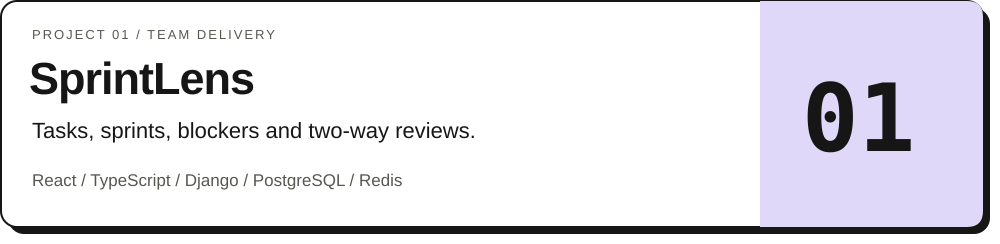
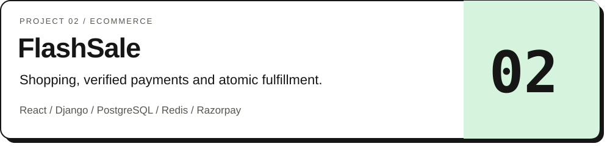
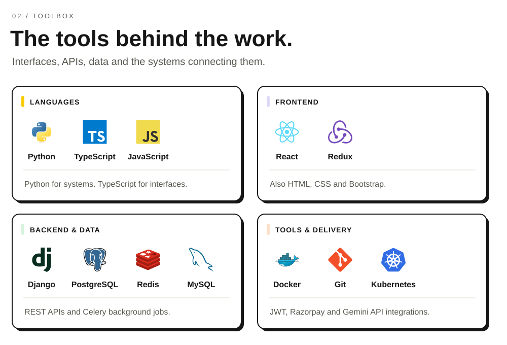

<picture><source media="(prefers-color-scheme: dark)" srcset="https://raw.githubusercontent.com/Shazil81/Shazil81/2881f0d9fb5b15389740f88a1d5821db83bc6a81/assets/identity-dark.svg" /></picture>

<a href="https://my-portfolio-three-brown-13.vercel.app/"><picture><source media="(prefers-color-scheme: dark)" srcset="assets/action-portfolio-dark.svg" /></picture></a>
<a href="https://my-portfolio-three-brown-13.vercel.app/shazil-resume.pdf"><picture><source media="(prefers-color-scheme: dark)" srcset="assets/action-resume-dark.svg" /></picture></a>
<a href="https://www.linkedin.com/in/shazil81"><picture><source media="(prefers-color-scheme: dark)" srcset="assets/action-linkedin-dark.svg" /></picture></a>
<a href="mailto:mohammadshazilmoin@gmail.com"><picture><source media="(prefers-color-scheme: dark)" srcset="assets/action-email-dark.svg" /></picture></a>

I connect **thoughtful interfaces with reliable backend systems** — from authentication and payments to background jobs and reporting.

 

<picture><source media="(prefers-color-scheme: dark)" srcset="assets/selected-dark.svg" /></picture>

<a href="https://github.com/Shazil81/SprintLens"><picture><source media="(prefers-color-scheme: dark)" srcset="assets/sprintlens-dark.svg" /></picture></a>

[Live demo ↗](https://sprintlens-kohl.vercel.app/) &nbsp; · &nbsp; [Source code](https://github.com/Shazil81/SprintLens)

Inside SprintLens — features and application preview

Role-based workflows, delivery analytics, GitHub integration, and authenticated reports. Celery and Redis support background processing; deployed reminders run through GitHub Actions.

 

<a href="https://github.com/Shazil81/flash-sale-ecommerce"><picture><source media="(prefers-color-scheme: dark)" srcset="assets/flashsale-dark.svg" /></picture></a>

[Live demo ↗](https://flash-sale-ecommerce.vercel.app/) &nbsp; · &nbsp; [Source code](https://github.com/Shazil81/flash-sale-ecommerce)

Inside FlashSale — features and application preview

Customer, administrator, and delivery-partner workflows. JWT authentication, Razorpay test checkout with server-side verification, PostgreSQL transaction locking, atomic fulfillment, and Redis caching.

 

<picture><source media="(prefers-color-scheme: dark)" srcset="assets/toolbox-dark.svg" /></picture>

About me, education and more projects

I’m **Mohammad Shazil Moin**, based in Patna, India.

- **M.Tech:** Information Technology (Courseware Engineering), Jadavpur University, 2026–2028.
- **B.Tech:** Computer Science & Engineering (Data Science), Brainware University, 2021–2025.
- **Analytics:** [Blinkit sales](https://github.com/Shazil81/Blinkit_Sales_Analysis) · [Credit card dashboard](https://github.com/Shazil81/Credit_Card_Dashboard)
- **Machine learning:** [Movie recommender](https://github.com/Shazil81/Movie_Recommender_System) · [Sentiment analysis](https://github.com/Shazil81/Sentiment_Analysis)
- **Problem solving:** [LeetCode](https://leetcode.com/u/890Shazil/) · [GeeksforGeeks](https://www.geeksforgeeks.org/profile/msmoin)

## 03 / Building in public

<picture><source media="(prefers-color-scheme: dark)" srcset="https://github-readme-stats-fast.vercel.app/api?username=Shazil81&amp;bg_color=171A20&amp;title_color=FACC00&amp;text_color=F7F5EE&amp;icon_color=B58B00&amp;border_color=3B414B&amp;border_radius=16&amp;disable_animations=true&amp;show_icons=true&amp;hide_rank=true" /></picture>

  

<picture><source media="(prefers-color-scheme: dark)" srcset="https://github-readme-stats-fast.vercel.app/api/streak?username=Shazil81&amp;bg_color=171A20&amp;title_color=FACC00&amp;text_color=F7F5EE&amp;icon_color=B58B00&amp;border_color=3B414B&amp;border_radius=16&amp;disable_animations=true&amp;show_icons=true&amp;hide_rank=true" /></picture>

  

<picture><source media="(prefers-color-scheme: dark)" srcset="https://github-readme-stats-fast.vercel.app/api/top-langs/?username=Shazil81&amp;bg_color=171A20&amp;title_color=FACC00&amp;text_color=F7F5EE&amp;icon_color=B58B00&amp;border_color=3B414B&amp;border_radius=16&amp;disable_animations=true&amp;layout=compact&amp;langs_count=8&amp;card_width=495" /></picture>

Public GitHub activity · Language share reflects repository code, not proficiency.

 

<a href="mailto:mohammadshazilmoin@gmail.com"><picture><source media="(prefers-color-scheme: dark)" srcset="https://raw.githubusercontent.com/Shazil81/Shazil81/2881f0d9fb5b15389740f88a1d5821db83bc6a81/assets/contact-dark.svg" /></picture></a>

[Email me](mailto:mohammadshazilmoin@gmail.com) · [Portfolio](https://my-portfolio-three-brown-13.vercel.app/) · [LinkedIn](https://www.linkedin.com/in/shazil81)

Custom artwork for Shazil. Visual inspiration: [Aahil Khan](https://github.com/aahil-khan/aahil-khan). Technology logos: [Devicon](https://github.com/devicons/devicon). Typography: Space Grotesk.
