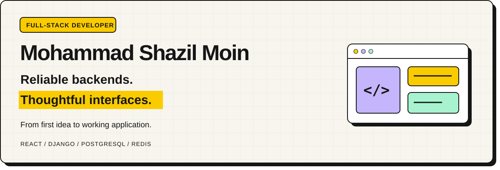

Full-stack developer building end-to-end web applications 
with React, Django, PostgreSQL, and Redis.

<a href="https://my-portfolio-three-brown-13.vercel.app/"><strong>Explore my portfolio ↗</strong></a>
&nbsp; · &nbsp;
<a href="https://www.linkedin.com/in/shazil81">LinkedIn</a>
&nbsp; · &nbsp;
<a href="mailto:mohammadshazilmoin@gmail.com">Email me</a>

---

### A little about me

I enjoy connecting responsive interfaces with robust backend systems. My work focuses on **API design, authentication, payment workflows, caching, and asynchronous processing**.

Based in **Patna, India**. Pursuing an **M.Tech in Information Technology (Courseware Engineering)** at Jadavpur University, following a B.Tech in Computer Science & Engineering (Data Science) at Brainware University.

## Selected work

### 01 / SprintLens

**Developer activity, delivery, and growth in one workspace.**

A team-delivery workspace for tasks, sprints, blockers, and two-way reviews, with role-based access for administrators, managers, and developers.

- **Delivery visibility:** analytics, audit trails, and GitHub activity integration.
- **Background processing:** Celery and Redis support jobs; deployed reminders run through GitHub Actions.
- **Reporting and insights:** authenticated PDF, CSV, and JSON reports, plus consent-based Gemini insights.

`React` `TypeScript` `Django REST Framework` `PostgreSQL` `Redis` `Celery`

**[Live demo ↗](https://sprintlens-kohl.vercel.app/)** &nbsp; / &nbsp; **[Explore the code](https://github.com/Shazil81/SprintLens)**

---

### 02 / FlashSale

**Shopping, payments, and delivery — connected.**

A full-stack ecommerce application with dedicated customer, administrator, and delivery-partner workflows.

- **Secure workflows:** JWT authentication and separate role-based portals.
- **Payment verification:** Razorpay test checkout with server-side verification.
- **Reliable fulfillment:** PostgreSQL transaction locking, atomic fulfillment, and Redis catalog caching.

`React` `Django REST Framework` `PostgreSQL` `Redis` `Razorpay`

**[Live demo ↗](https://flash-sale-ecommerce.vercel.app/)** &nbsp; / &nbsp; **[Explore the code](https://github.com/Shazil81/flash-sale-ecommerce)**

---

## My toolkit

### Frontend

  
  
  
  
  
  
  

React · TypeScript · JavaScript · Redux · HTML · CSS · Bootstrap

### Backend & data

  
  
  
  
  

Python · Django · Django REST Framework · Celery · PostgreSQL · MySQL · Redis

### Tools & integrations

  
  
  
  

Git · GitHub · Docker · Kubernetes · JWT · Razorpay · Gemini API

## GitHub activity

  

  

Public GitHub activity · Language share reflects repository code, not proficiency.

## Beyond full-stack

I also explore data analysis, machine learning, and problem solving.

- **Analytics:** [Blinkit sales](https://github.com/Shazil81/Blinkit_Sales_Analysis) · [Credit card dashboard](https://github.com/Shazil81/Credit_Card_Dashboard) · [IPL data](https://github.com/Shazil81/IPL_Data_Analysis)
- **Machine learning:** [Movie recommender](https://github.com/Shazil81/Movie_Recommender_System) · [Sentiment analysis](https://github.com/Shazil81/Sentiment_Analysis)
- **Problem solving:** [LeetCode](https://leetcode.com/u/890Shazil/) · [GeeksforGeeks](https://www.geeksforgeeks.org/profile/msmoin) · [DSA solutions](https://github.com/Shazil81/LeetCode-DSA)

---

<h3>Let’s build something useful.</h3>

Interested in my work or want to discuss a project?

<a href="mailto:mohammadshazilmoin@gmail.com"><strong>Get in touch ↗</strong></a>
&nbsp; · &nbsp;
<a href="https://my-portfolio-three-brown-13.vercel.app/">View portfolio</a>
&nbsp; · &nbsp;
<a href="https://www.linkedin.com/in/shazil81">Connect on LinkedIn</a>

